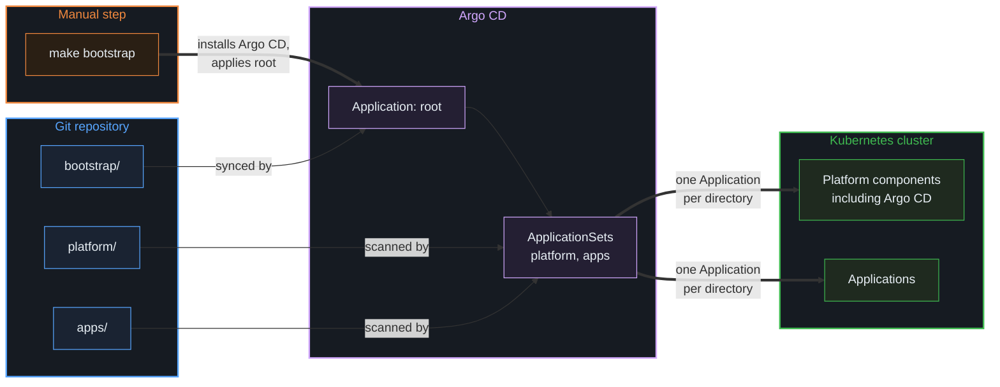
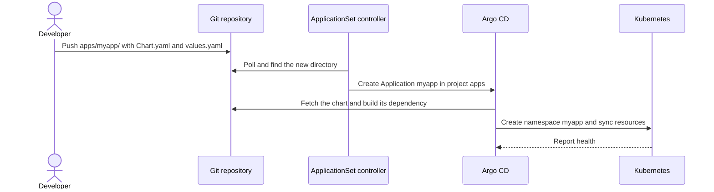

# GitOps

Argo CD deploys everything in the cluster from this repository. Only Argo CD itself and the root application are installed by hand, with `make bootstrap`.

## Structure

The `root` application watches `bootstrap/`, so changes to projects and ApplicationSets also go through Git. Argo CD manages itself through `platform/argocd/`, like any other platform component. That application takes over the Helm release installed by `make bootstrap`.

## Adding an application

## ApplicationSets

An ApplicationSet is a template that creates Application resources. Each ApplicationSet scans a directory in this repository and creates one Application for each subdirectory. Adding a directory with `Chart.yaml` and `values.yaml` is enough to deploy something new.

### Generated values

The directory `platform/argocd` produces these values:

| Variable | Value | Used for |
|---|---|---|
| `{{.path.basename}}` | `argocd` | Application name, namespace and Helm release name |
| `{{.path.path}}` | `platform/argocd` | Path to the chart in the repository |

Everything else in the template is the same for all applications, including automated sync with pruning, self-healing and retries.

### Differences

| | `platform` | `apps` |
|---|---|---|
| Scans | `platform/*` | `apps/*` |
| Project | `platform` | `apps` |
| Removing a directory | Deletes the Application, keeps its resources | Deletes the Application and its resources |

There are two ApplicationSets for two reasons:

- **Permissions:** the project is hardcoded in each ApplicationSet, so a directory cannot choose its own permissions.
- **Deletion:** platform components are protected against accidental removal. Without this, removing `platform/argocd/` could delete Argo CD itself.

## Projects

| | `platform` | `apps` |
|---|---|---|
| Source | This repository | This repository |
| Namespaces | All | All except `kube-system` and `argocd` |
| Cluster-scoped resources | All | `Namespace` only |

The `root` application uses the built-in `default` project, because it creates the other projects.

## Constraints

- The directory name must be a valid Kubernetes name, and unique across `platform/` and `apps/`.
- Each directory gets a namespace with the same name.
- Renaming a directory works as a removal followed by an addition. In `apps/`, the old resources are deleted.
- Manual changes to generated Applications are overwritten. Changes are made in Git.
- Argo CD discovers new directories by polling Git, so a new application appears after a short delay.
- Applications sync independently, with no ordering between them. A sync that fails, for example because a CRD does not exist yet, is retried with backoff.
